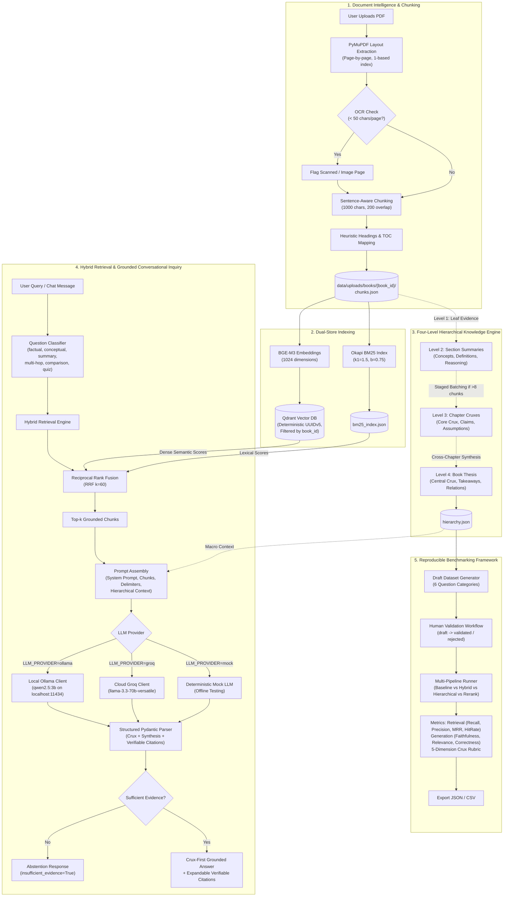

# BookMind — Domain-Specialized Book-Understanding RAG Application

BookMind is a domain-specialized Retrieval-Augmented Generation (RAG) platform engineered for comprehensive book comprehension, bottom-up hierarchical knowledge extraction, evidence-grounded conversational inquiry, and reproducible empirical benchmarking.

Unlike shallow pass-through document chatbots that blindly slice text into detached fragments, BookMind combines high-fidelity layout extraction, dense multilingual embeddings (**BGE-M3**), an embedded or remote vector database (**Qdrant**), lexical keyword scoring (**Okapi BM25**), rank fusion (**RRF**), a four-tier hierarchical synthesis engine, and dual LLM inference (**Local Ollama** with `qwen2.5:3b` or **Cloud Groq** with `llama-3.3-70b-versatile`).

---

## The Problem BookMind Solves

Standard RAG architectures struggle when applied to entire books:
1. **Loss of Global Context**: Naive top-$k$ chunk retrieval answers micro-questions but misses macro-arguments, chapter-level themes, and author theses.
2. **Ungrounded Hallucinations & Lost Provenance**: Models assert claims without precise page references or verbatim citations, making verification impossible.
3. **Keyword vs. Semantic Blindspots**: Pure dense vector search misses exact terminology, proper nouns, and code symbols, while pure keyword search misses conceptual paraphrasing.
4. **Vague Answers to Comparative Queries**: Questions comparing concepts across distant chapters (e.g. Chapter 1 vs Chapter 7) fail when retrieval only looks at isolated local neighborhoods.
5. **Lack of Abstention**: Standard systems hallucinate confident answers to out-of-scope questions rather than gracefully acknowledging absence of evidence.
6. **Cloud Lock-in & Privacy Risks**: Sensitive or proprietary books cannot be sent to third-party cloud APIs.

BookMind solves these challenges through **strict book-isolated hybrid retrieval**, a **four-level knowledge hierarchy**, **crux-first answer synthesis with verbatim page citations**, and **zero-token local Ollama inference**.

---

## Architecture Overview



---

## Technology Stack & Component Purpose

| Layer | Technology | Version / Model | Specific Role |
| :--- | :--- | :--- | :--- |
| **Backend Framework** | FastAPI | `0.115.0+` | Asynchronous RESTful API, dependency injection, and OpenAPI contract |
| **Server** | Uvicorn | `0.30.0+` | ASGI web server for high-throughput local execution |
| **Configuration** | Pydantic Settings | `v2` | Strongly-typed environment parsing with `.env` / `../.env` fallback |
| **PDF Ingestion** | PyMuPDF (`fitz`) | `1.24.0+` | Direct layout parsing, 1-based page boundary preservation, OCR detection |
| **Dense Embeddings** | BGE-M3 | `BAAI/bge-m3` | 1024-dimensional multilingual embeddings via CPU or GPU |
| **Vector Database** | Qdrant | `v1.11.0+` | Local embedded directory storage (`data/qdrant_storage`) or remote cluster |
| **Lexical Search** | Okapi BM25 | Pure Python | Standalone inverted index with smoothed IDF and length normalization |
| **Hybrid Fusion** | Reciprocal Rank Fusion | Mathematical $k=60$ | Non-parametric rank merging balancing dense semantics and exact keywords |
| **Local LLM** | Ollama | `qwen2.5:3b` | 100% offline, zero-token inference on Windows (GPU-accelerated via RTX 3050) |
| **Cloud LLM (Optional)** | Groq | `llama-3.3-70b-versatile` | Ultra-fast cloud inference with native JSON schema mode |
| **Frontend Framework** | React | `19.3.1` | Modern reactive user interface with hooks and component modularity |
| **Build Tooling** | Vite | `8.3.4` | Ultra-fast HMR and production bundling |
| **Styling** | Tailwind CSS & Vanilla CSS | `v4.3.3` | Claude-inspired warm neutral design (`#FAF9F5`), Newsreader + Inter fonts |
| **Icons** | Lucide React | `1.60.0` | Crisp SVG iconography |
| **Testing** | Pytest & Vitest | Pytest 9.1 / Vitest 5.0 | 70 backend test cases + 12 frontend unit/integration test cases |

---

## Core Implemented Features

### 1. High-Fidelity PDF Ingestion & OCR Detection
- **Page-Aware Text Extraction**: Extracts text sequentially using PyMuPDF while strictly preserving 1-based page numbers.
- **OCR Need Detection**: Automatically computes character density per page. Pages falling below `OCR_THRESHOLD_MIN_CHARS_PER_PAGE=50` are flagged with actionable OCR warnings.
- **Heading Structure Heuristics**: Extracts chapter and section headings using document Table of Contents (TOC) metadata when present, falling back to layout font-size heuristics.
- **Sentence & Paragraph Chunking**: Bounded chunks (`DEFAULT_CHUNK_SIZE=1000`, `DEFAULT_CHUNK_OVERLAP=200`) prevent splitting sentences mid-thought while keeping page span metadata intact.
- **Filesystem Isolation**: Ingested book assets, extracted chunks, and indexes are isolated under `data/uploads/books/{book_id}/`.

### 2. Dense Embeddings & Vector Storage
- **BGE-M3 Embeddings**: 1024-dimensional dense vectors capturing multi-lingual semantics.
- **Embedded or Cloud Qdrant**: Operates by default in embedded mode saving directly to `data/qdrant_storage` without requiring Docker. Supports switching to a remote Qdrant Cloud cluster by specifying `QDRANT_URL` and `QDRANT_API_KEY`.
- **Deterministic Point IDs**: Generates UUIDv5 identifiers from `f"{book_id}:{chunk_id}"` ensuring re-indexing is completely idempotent without duplicate points.
- **Strict Tenant Filtering**: All Qdrant vector operations enforce `must=[FieldCondition(key="book_id", match=MatchValue(value=book_id))]` preventing cross-book vector leakage.

### 3. Okapi BM25 & Reciprocal Rank Fusion (RRF)
- **Deterministic BM25**: Custom Okapi BM25 implementation using smoothed IDF ($\ln(1 + \frac{N - n + 0.5}{n + 0.5})$) and document length normalization ($k_1=1.5, b=0.75$).
- **Reciprocal Rank Fusion**: Merges lexical and dense semantic rankings using:
  $$RRF\_score(d) = \sum_{m \in \{semantic, bm25\}} \frac{1}{k + rank_m(d)} \quad (k=60)$$
- Preserves complete chunk metadata through all retrieval stages.

### 4. Four-Level Hierarchical Book Understanding
BookMind organizes book knowledge into four distinct tiers:
1. **Level 1 (Evidence Chunks)**: Immutable raw text passages with verbatim page spans and unique chunk IDs.
2. **Level 2 (Section Summaries)**: Concise section summaries, defined terms, key concepts (marked author-stated vs model-inferred), and sequential reasoning chains.
3. **Level 3 (Chapter Cruxes)**: Chapter core crux, central arguments, supporting claims, assumptions, examples, counterexamples, and cross-chapter prerequisite connections. Chapters with $>8$ chunks use staged batching to prevent context loss.
4. **Level 4 (Book Crux & Thesis)**: Whole-book overarching thesis, global crux, essential takeaways, and chapter relationship matrices.

All hierarchical summaries are stored in a dedicated `hierarchy.json` file, preserving the original leaf evidence chunks untouched.

### 5. Grounded Conversational RAG with Verifiable Citations
- **Query Classification**: Incoming inquiries are automatically classified into `factual`, `conceptual`, `chapter_summary`, `book_crux`, `cross_chapter_comparison`, or `quiz`.
- **Crux-First Response Structure**: Every response delivers the essential conclusion first before expanding into multi-passage evidence.
- **Verifiable Structured Citations**: Claims include structured citations specifying `chunk_id`, `page_start`, `page_end`, `chapter`, and verbatim `quoted_snippet`.
- **Active Abstention**: When evidence is missing or the book does not cover the topic, BookMind sets `insufficient_evidence=True` and abstains from hallucinating.
- **Prompt Injection Defense**: Retrieved book chunks are fenced using explicit delimiters, instructing the model to treat retrieved passages strictly as passive reference text.
- **Multi-Turn History**: Conversation threads are tracked and stored in `conversations/{conversation_id}.json`.

### 6. Local Ollama & Cloud Groq Dual Inference
- **Local Ollama Mode (Default)**: Connects to `http://localhost:11434` with model `qwen2.5:3b`. Includes automatic model installation verification via `/api/tags`, bounded context options (`num_ctx: 4096`, `num_predict: 2048`), JSON schema enforcement, and markdown code fence cleaning.
- **Zero Cloud Leakage**: When configured for Ollama, BookMind never calls external APIs and never silently falls back to Groq.
- **Cloud Groq Mode**: Preserved for optional cloud inference using `llama-3.3-70b-versatile` with native JSON mode.
- **Mock Mode**: Deterministic offline client for reproducible unit testing.

### 7. Reproducible RAG Evaluation Framework
- **Dataset Synthesis**: Semi-automated generation of draft questions across 6 categories: `factual`, `conceptual`, `summarization`, `multi_hop`, `comparison`, and `unanswerable`.
- **Mandatory Human Validation**: Draft items must be manually reviewed and marked `validated` before benchmark execution.
- **Multi-Pipeline Benchmarking**: Compares `baseline_rag`, `hybrid_rag`, `hierarchical_rag`, and `hierarchical_rag_rerank`.
- **Quantitative Metrics**:
  - *Retrieval*: Recall@k, Precision@k, MRR, HitRate@k.
  - *Generation*: Faithfulness, Unsupported Claim Rate, Answer Relevance, Answer Correctness, Abstention Quality.
  - *Crux Rubric*: 5 uncollapsed dimensions (Essential Concepts Coverage, Central Thesis Representation, Qualifications Retained, Supporting Reasoning, Cross-Chapter Connections).
- **Export Formats**: Complete benchmark runs exportable to JSON and CSV via REST API and CLI (`scripts/evaluate_rag.py`).

---

## Installation & Setup (Windows PowerShell)

### Prerequisites
- **Python 3.11+** (Tested on Python 3.12.3)
- **Node.js 18+** (Tested on Node v22.19.0 / npm 10.9.3)
- **Ollama for Windows** (For local inference)
- **NVIDIA GPU** (Optional; verified on NVIDIA GeForce RTX 3050 Laptop GPU, 4 GB VRAM)

---

### Step 1: Clone and Configure Environment

```powershell
# Clone the repository
git clone https://github.com/nikhilthakur74/BookMind.git
cd BookMind

# Copy the environment configuration template
Copy-Item .env.example backend\.env
```

Review `backend\.env`. The default settings run BookMind **100% locally** using Ollama and embedded Qdrant:

```ini
LLM_PROVIDER=ollama
OLLAMA_BASE_URL=http://localhost:11434
OLLAMA_MODEL=qwen2.5:3b
QDRANT_URL=
QDRANT_COLLECTION=bookmind_chunks
EMBEDDING_PROVIDER=auto
EMBEDDING_MODEL=BAAI/bge-m3
```

---

### Step 2: Set Up Local Ollama Inference

If running locally:

```powershell
# 1. Start Ollama service (if not running in background)
Start-Process ollama serve

# 2. Pull the lightweight 3B reasoning model
ollama pull qwen2.5:3b

# 3. Verify Ollama and installed models
ollama list
curl.exe -s http://localhost:11434/api/tags
```

---

### Step 3: Backend Setup & Testing

Open a PowerShell terminal:

```powershell
# Navigate to backend directory
cd C:\bookreader\backend

# Create and activate Python virtual environment
python -m venv .venv
.\.venv\Scripts\Activate.ps1

# Install backend dependencies
pip install -r requirements.txt

# Run the automated pytest test suite (70 tests passing)
pytest -v

# Start the FastAPI development server
uvicorn app.main:app --host 127.0.0.1 --port 8000 --reload
```

The backend is accessible at:
- **Root Status**: [http://127.0.0.1:8000/](http://127.0.0.1:8000/)
- **Health Check**: [http://127.0.0.1:8000/api/health](http://127.0.0.1:8000/api/health)
- **Interactive Swagger Docs**: [http://127.0.0.1:8000/docs](http://127.0.0.1:8000/docs)
- **ReDoc**: [http://127.0.0.1:8000/redoc](http://127.0.0.1:8000/redoc)

---

### Step 4: Frontend Setup & Testing

Open a second PowerShell terminal:

```powershell
# Navigate to frontend directory
cd C:\bookreader\frontend

# Install frontend dependencies
npm install

# Run automated vitest tests (12 tests passing)
npm run test

# Run frontend production build
npm run build

# Start the Vite development server
npm run dev -- --host 127.0.0.1 --port 5173
```

The frontend interface will open at:
- **BookMind Application**: [http://127.0.0.1:5173](http://127.0.0.1:5173)

---

## How to Use BookMind

### 1. Ingest a Book
1. Open the web interface at `http://127.0.0.1:5173`.
2. Click **Upload Book** in the navigation header or sidebar.
3. Select any standard `.pdf` document (up to 50 MB).
4. The system validates the header, extracts text page-by-page, checks for OCR requirements, extracts headings, and creates overlapping sentence-aware text chunks.

### 2. Index Book Chunks
1. Once uploaded, click **Index Book**.
2. BookMind computes dense 1024-dimensional BGE-M3 embeddings, stores them in Qdrant with deterministic IDs, and builds the Okapi BM25 keyword index on disk.

### 3. Generate Four Knowledge Levels
1. Click **Synthesize Hierarchy**.
2. The hierarchical engine processes chunks bottom-up, generating Section Summaries, Chapter Cruxes, and the overall Book Thesis.

### 4. Ask Evidence-Grounded Questions
1. In the chat input, ask any question about the book (e.g. *"What is the primary mechanism of consensus?"* or *"Compare Chapter 1 and Chapter 3"*).
2. BookMind retrieves the most relevant passages using BM25 + BGE-M3 Reciprocal Rank Fusion, classifies the query, and formats a **Crux-First response**.
3. Click any **Citation Pill** below the response to view the verbatim quoted snippet, chunk ID, chapter, and source page numbers.
4. If you ask a question outside the book's domain (e.g. baking recipes for a distributed systems book), BookMind will explicitly state that evidence is insufficient.

### 5. Benchmark RAG Performance
1. Navigate to the **Evaluation** tab.
2. Generate or inspect a 6-category evaluation dataset.
3. Mark draft questions as validated.
4. Run the benchmark across multiple pipelines and review retrieval metrics, faithfulness scores, and the 5-dimension crux rubric.

---

## API Reference Summary

### Health & Diagnostics
- `GET /api/health` — Application status, version, and optional LLM reachability probe.
- `GET /api/health/llm` — In-depth LLM diagnostics, model installation check, and live test generation.

### Books & Ingestion
- `POST /api/books/upload` — Upload and parse a PDF book.
- `GET /api/books` — Catalog of all ingested books with page and chunk counts.
- `GET /api/books/{book_id}` — Book metadata, detected headings, and OCR warnings.
- `GET /api/books/{book_id}/chunks` — Paginated list of raw text chunks with page bounds.
- `DELETE /api/books/{book_id}` — Delete book, chunks, vector points, and conversation history.

### Indexing & Retrieval
- `POST /api/books/{book_id}/index` — Trigger BGE-M3 embedding generation, Qdrant upsert, and BM25 index build.
- `GET /api/books/{book_id}/indexing-status` — Inspect vector and lexical index status.
- `POST /api/books/{book_id}/retrieve` — Execute isolated hybrid, dense, or lexical retrieval.

### Hierarchical Understanding
- `POST /api/books/{book_id}/hierarchy/generate` — Trigger or resume bottom-up hierarchical synthesis.
- `GET /api/books/{book_id}/hierarchy` — Retrieve the four-level knowledge structure.
- `GET /api/books/{book_id}/hierarchy/status` — Inspect hierarchical generation progress.

### Conversational Inquiry
- `POST /api/books/{book_id}/chat` — Ask a grounded question with structured citations.
- `GET /api/books/{book_id}/conversations` — List active conversation threads for a book.
- `GET /api/books/{book_id}/conversations/{conversation_id}` — Retrieve full message thread history.

### Evaluation Framework
- `POST /api/books/{book_id}/evaluations/datasets/generate` — Generate draft evaluation dataset.
- `GET /api/books/{book_id}/evaluations/datasets` — List versioned datasets for a book.
- `PUT /api/books/{book_id}/evaluations/datasets/{dataset_id}/items/{item_id}` — Review and validate dataset items.
- `POST /api/books/{book_id}/evaluations/runs` — Run comparative RAG benchmark across pipelines.
- `GET /api/books/{book_id}/evaluations/runs/{run_id}` — Get detailed run results.
- `GET /api/books/{book_id}/evaluations/compare` — Compare multiple evaluation runs.

---

## Configuration Reference

All settings can be configured via environment variables or in `backend/.env`:

| Setting | Type | Default | Description |
| :--- | :---: | :--- | :--- |
| `APP_NAME` | `str` | `"BookMind API"` | Display name for the application |
| `ENVIRONMENT` | `str` | `"development"` | Active environment (`development`, `production`, `test`) |
| `DEBUG` | `bool` | `true` | Enables auto-reload and verbose logging |
| `API_V1_PREFIX` | `str` | `"/api"` | Base API routing prefix |
| `HOST` | `str` | `"127.0.0.1"` | Host IP to bind server to |
| `PORT` | `int` | `8000` | HTTP port for backend server |
| `CORS_ORIGINS` | `list` | `["http://localhost:5173", ...]` | Allowed CORS origins for frontend client |
| `MAX_UPLOAD_SIZE_BYTES`| `int` | `52428800` (50 MB) | Maximum permitted PDF file size |
| `DEFAULT_CHUNK_SIZE` | `int` | `1000` | Target character length for text chunks |
| `DEFAULT_CHUNK_OVERLAP`| `int` | `200` | Character overlap between adjacent chunks |
| `OCR_THRESHOLD_MIN_CHARS_PER_PAGE` | `int` | `50` | Threshold below which page triggers OCR warning |
| `LLM_PROVIDER` | `str` | `"ollama"` | Active LLM provider (`ollama`, `groq`, or `mock`) |
| `OLLAMA_BASE_URL` | `str` | `"http://localhost:11434"` | Endpoint URL for Ollama local service |
| `OLLAMA_MODEL` | `str` | `"qwen2.5:3b"` | Model tag to use in local Ollama |
| `OLLAMA_NUM_CTX` | `int` | `4096` | Context window size (bounded for 4GB VRAM GPU) |
| `OLLAMA_NUM_PREDICT` | `int` | `2048` | Maximum tokens generated per LLM response |
| `OLLAMA_TEMPERATURE` | `float` | `0.1` | Sampling temperature for factual consistency |
| `GROQ_API_KEY` | `str` | `""` | API key required only if `LLM_PROVIDER=groq` |
| `GROQ_MODEL` | `str` | `"llama-3.3-70b-versatile"` | Active model when using Groq provider |
| `QDRANT_URL` | `str` | `""` | Remote Qdrant URL. Leave empty for local embedded storage |
| `QDRANT_API_KEY` | `str` | `""` | API key required only for Qdrant Cloud |
| `QDRANT_COLLECTION` | `str` | `"bookmind_chunks"` | Target Qdrant collection name |
| `QDRANT_STORAGE_DIR` | `str` | `"data/qdrant_storage"` | Directory for embedded local Qdrant vectors |
| `EMBEDDING_MODEL` | `str` | `"BAAI/bge-m3"` | HuggingFace embedding model identifier |
| `EMBEDDING_DEVICE` | `str` | `"cpu"` | Embedding compute device (`cpu`, `cuda`, `mps`, `auto`) |
| `BM25_K1` | `float` | `1.5` | Okapi BM25 term frequency saturation parameter |
| `BM25_B` | `float` | `0.75` | Okapi BM25 document length normalization parameter |
| `RRF_K` | `int` | `60` | Reciprocal Rank Fusion smoothing parameter |
| `ENABLE_RERANKER` | `bool` | `false` | Enable cross-encoder reranker stage |
| `UPLOAD_DIR` | `str` | `"data/uploads"` | Root directory for uploaded books and metadata |

---

## Verification & Testing

### Backend Automated Test Suite
The backend contains 70 comprehensive pytest test cases covering PDF parsing, chunking, deduplication, OCR detection, BM25 ranking, RRF precision, Qdrant isolation, hierarchical knowledge generation, Ollama connectivity, error retries, and evaluation metrics:

```powershell
cd C:\bookreader\backend
.\.venv\Scripts\Activate.ps1
pytest -v
```

*Result: 70 passed in ~50 seconds.*

### Frontend Vitest Suite & Build
The frontend includes 12 automated unit and integration tests covering API client error handling, Markdown rendering, citation expansion, and component rendering:

```powershell
cd C:\bookreader\frontend
npm run test
npm run build
```

*Result: 12 passed in 3 test files. Production bundle built cleanly with zero errors.*

---

## Known Limitations

1. **Scanned PDF OCR**: The ingestion pipeline detects pages with minimal extractable text and flags them with an `ocr_warning`. However, an external OCR engine (like Tesseract) is required to transcribe pixel-only scanned pages into text.
2. **Embedded Qdrant Concurrency**: When running Qdrant in local embedded mode (`QDRANT_URL=""`), Qdrant locks its SQLite storage file for exclusive access by the active backend process. If multiple workers or concurrent uvicorn processes are used, configure a remote or Dockerized Qdrant instance.
3. **Local VRAM Constraints**: `qwen2.5:3b` runs comfortably within 4 GB VRAM on mobile GPUs (such as the NVIDIA RTX 3050 Laptop GPU). Larger local models (such as `qwen2.5:7b` or `llama-3.1:8b`) may exceed 4 GB VRAM and trigger CPU offloading with higher latency.
4. **Complex Multi-Column Layouts**: Layout heading detection relies on TOC structure and font size heuristics. Extremely complex magazine-style multi-column PDFs may require manual heading curation.

---

## Future Improvements

- [ ] Native Tesseract OCR integration for automated fallback transcription on image-only PDF pages.
- [ ] Streaming response support (`text/event-stream`) for real-time token rendering during chat synthesis.
- [ ] Cross-encoder reranking fine-tuned specifically on long-form academic and literary literature.
- [ ] EPUB and MOBI format ingestion pipelines.
- [ ] Graph-based entity relation visualization across chapters.

---

## Repository Structure

```
BookMind/
├── .env.example                            # Root environment variable template
├── .gitignore                              # Comprehensive git ignore rules
├── README.md                               # Complete system documentation
├── PHASE7_FRONTEND_GUIDE.md                # Frontend architectural guide & manual test checklist
├── bookmind_overall_status_report.md       # Development progress & architectural status report
├── data/
│   ├── qdrant_storage/
│   │   └── .gitkeep                        # Local vector database storage directory
│   └── uploads/
│       └── .gitkeep                        # Local book assets & chunks storage directory
├── backend/
│   ├── .env.example                        # Backend environment template
│   ├── pyproject.toml                      # Packaging & pytest configuration
│   ├── requirements.txt                    # Verified Python dependencies
│   ├── evaluation_report_summary.csv       # Sample reproducible benchmark summary report
│   ├── evaluation_report_full.json         # Sample detailed benchmark run output
│   ├── app/
│   │   ├── main.py                         # FastAPI app factory, CORS & root routes
│   │   ├── api/
│   │   │   ├── router.py                   # API router aggregator
│   │   │   └── endpoints/
│   │   │       ├── health.py               # /api/health and /api/health/llm
│   │   │       ├── books.py                # Upload, ingest, index, retrieve, chat, hierarchy
│   │   │       └── evaluations.py          # Dataset generation, validation, benchmark runs
│   │   ├── core/
│   │   │   └── config.py                   # Pydantic Settings & environment schema
│   │   ├── evaluation/
│   │   │   ├── dataset_service.py          # Dataset lifecycle & draft question synthesis
│   │   │   ├── runner.py                   # Multi-pipeline comparative experiment runner
│   │   │   ├── judge.py                    # LLM-as-a-judge evaluation logic
│   │   │   ├── export.py                   # JSON and CSV result serialization
│   │   │   ├── schemas.py                  # Evaluation domain schemas
│   │   │   └── metrics/
│   │   │       ├── retrieval.py            # Recall@k, Precision@k, MRR, HitRate@k
│   │   │       ├── generation.py           # Faithfulness, Relevance, Correctness, Abstention
│   │   │       └── crux_rubric.py          # 5-dimension Crux Completeness Rubric
│   │   ├── schemas/
│   │   │   ├── book.py                     # Book, Chunk, Heading, and Page schemas
│   │   │   ├── health.py                   # HealthResponse schemas
│   │   │   ├── retrieval.py                # RetrievalRequest and RetrievalResponse
│   │   │   ├── hierarchy.py                # Section, Chapter, and Book Hierarchy schemas
│   │   │   └── chat.py                     # ChatRequest, ChatResponse, Citation schemas
│   │   └── services/
│   │       ├── pdf_service.py              # PyMuPDF extraction, OCR heuristics, chunking
│   │       ├── storage_service.py          # Filesystem book asset manager
│   │       ├── qdrant_service.py           # Qdrant client, indexing, and vector search
│   │       ├── embedding_service.py        # BGE-M3 embedding wrapper
│   │       ├── bm25_service.py             # Standalone Okapi BM25 engine
│   │       ├── fusion_service.py           # Reciprocal Rank Fusion implementation
│   │       ├── indexing_service.py         # Dual-store orchestration
│   │       ├── retrieval_service.py        # Isolated hybrid retrieval service
│   │       ├── hierarchy_service.py        # Four Knowledge Levels synthesis engine
│   │       ├── llm_client.py               # Ollama, Groq, and Mock LLM clients
│   │       ├── conversation_service.py     # Thread persistence
│   │       ├── reranker_service.py         # Cross-encoder reranking
│   │       └── chat_service.py             # Conversational RAG pipeline
│   ├── scripts/
│   │   ├── evaluate_rag.py                 # CLI benchmark runner
│   │   ├── run_phase6_evaluation_experiment.py # Reproducible benchmark experiment
│   │   └── e2e_phase5_verification.py      # End-to-end integration check
│   └── tests/
│       ├── test_health.py                  # Health check tests
│       ├── test_books.py                   # PDF ingestion, chunking, OCR tests
│       ├── test_indexing.py                # Vector & lexical indexing tests
│       ├── test_retrieval.py               # BM25, RRF, and isolation tests
│       ├── test_hierarchy.py               # Four Knowledge Levels synthesis tests
│       ├── test_chat.py                    # Conversational RAG, citations, abstention tests
│       ├── test_ollama.py                  # Local Ollama client & error handling tests
│       └── test_evaluation.py              # Evaluation metrics & benchmark tests
└── frontend/
    ├── package.json                        # Node dependencies and scripts
    ├── package-lock.json                   # Deterministic dependency lockfile
    ├── tsconfig.json                       # Root TypeScript configuration
    ├── tsconfig.app.json                   # Frontend app TypeScript options
    ├── tsconfig.node.json                  # Vite TypeScript options
    ├── vite.config.ts                      # Vite configuration with Tailwind CSS v4
    ├── index.html                          # Entry HTML with Newsreader & Inter typography
    ├── README.md                           # Frontend overview
    ├── .oxlintrc.json                      # Oxlint linter configuration
    ├── public/
    │   ├── favicon.svg                     # BookMind favicon
    │   └── icons.svg                       # Icon sprite
    └── src/
        ├── main.tsx                        # React application entrypoint
        ├── App.tsx                         # Main layout, tabs, and state coordinator
        ├── index.css                       # Design tokens, variables, Tailwind directives
        ├── App.css                         # Layout styles
        ├── types/
        │   └── api.ts                      # Strongly-typed TypeScript API models
        ├── lib/
        │   └── api.ts                      # Typed API client with error handling
        ├── pages/
        │   ├── Home.tsx                    # Claude-inspired home layout
        │   └── EvaluationDashboard.tsx     # Full benchmark evaluation interface
        ├── components/
        │   ├── Header.tsx                  # Header with real-time connection status
        │   ├── Sidebar.tsx                 # Book catalog & conversation history sidebar
        │   ├── ChatWorkspace.tsx           # Conversational inquiry & chip prompts
        │   ├── CitationsView.tsx           # Expandable evidence cards with quotes
        │   ├── MarkdownRenderer.tsx        # Zero-dependency styled markdown parser
        │   ├── UploadModal.tsx             # Multi-stage PDF upload modal
        │   ├── HierarchyModal.tsx          # Four Knowledge Levels inspector modal
        │   ├── HealthCard.tsx              # Diagnostic monitor card
        │   ├── PipelineOverview.tsx        # System pipeline overview
        │   └── BookUploadPlaceholder.tsx   # Dropzone placeholder
        └── test/
            ├── api.test.ts                 # API client unit tests
            ├── MarkdownRenderer.test.tsx   # Markdown renderer tests
            └── CitationsView.test.tsx      # Citation expansion tests
```
